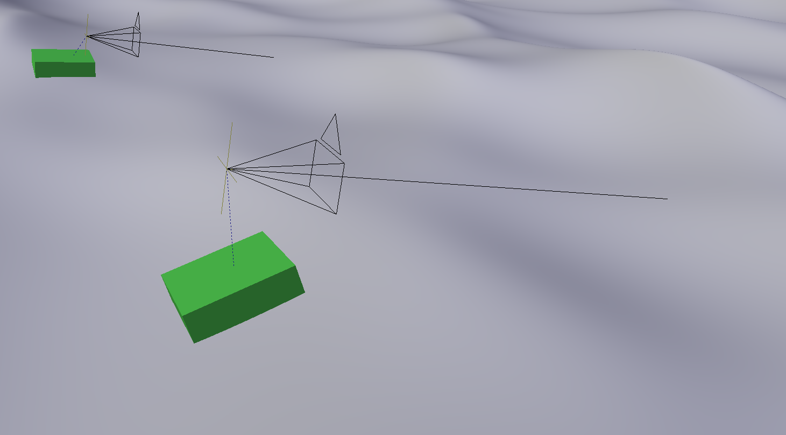
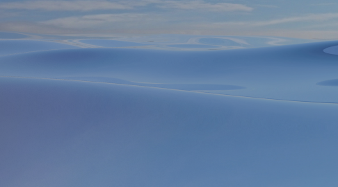
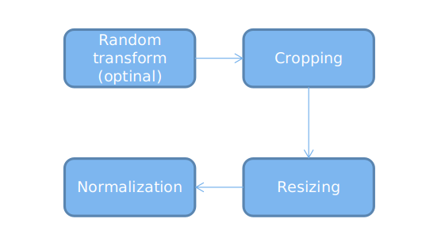
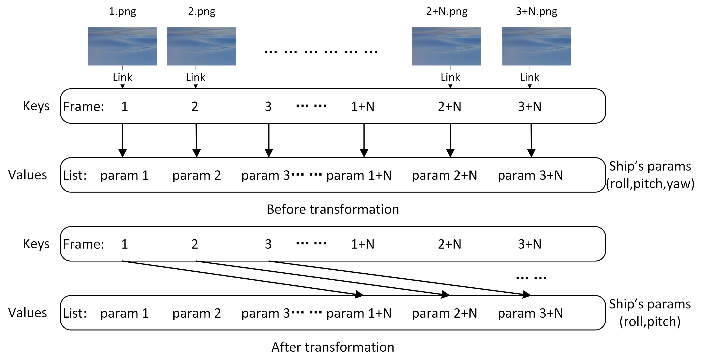
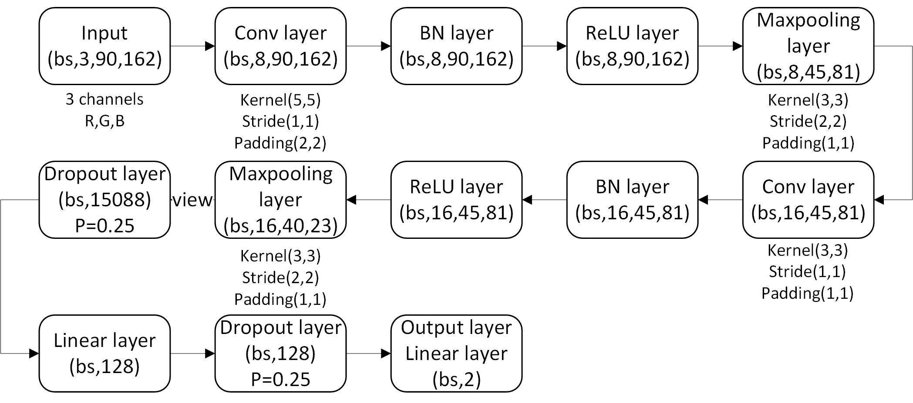
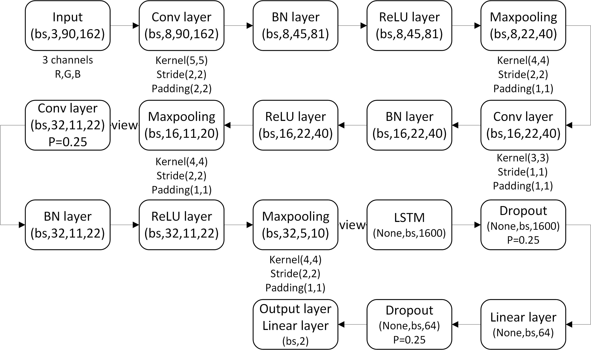

# Preproyecto: Predicción del movimiento de un barco mediante aprendizaje automático
***Autor:*** [Zhi ZHOU](https://github.com/zroykhi)
# Resumen

<div align='center'\>
　　
   <br />
   Plan
</div>

### Simulación en Blender

Para estos primeros experimentos, he utilizado una simulación simple que solo representa que el barco responderá al movimiento del mar, sin buscar una precisión física ni una gran realismo en las imágenes de las olas. Por eso, he simulado un mar en movimiento con dos barcos representados como cubos simples flotando sobre él, utilizando un modelo físico [simple](3dmodel/model.blend). Aquí hay dos tutoriales sobre cómo configurar el [movimiento](https://www.youtube.com/watch?v=sfi7HW8qHAo) y aplicar [texturas](https://www.youtube.com/watch?v=-GW8jMsQhEU) a los objetos.

Simulación 3D en Blender | Ejemplo de imagen de superficie marina generada
:-------------------------:|:-------------------------:
  | 

### Preprocesamiento de datos

Los parámetros de movimiento del barco se recopilan en un archivo JSON en forma de diccionario, que es una colección no ordenada de pares nombre-valor. Los nombres (también llamados claves) corresponden a números de fotograma, siendo cada clave el nombre de una imagen de superficie marina recopilada, y el valor asociado es una lista de los parámetros de movimiento del barco. Como queremos evaluar cuánto tiempo antes la predicción del movimiento del barco tiene mejor rendimiento, creamos conjuntos de datos con diferentes retrasos temporales, asociando cada imagen con el valor de la imagen N pasos (es decir, diferencia de fotogramas) después, manteniendo los parámetros correspondientes del barco sin cambios (ver figura abajo).

Preprocesamiento de imágenes | Preprocesamiento de parámetros de movimiento del barco
:-------------------------:|:-------------------------:
  | 

### Modelos

Los modelos de red neuronal que he creado incluyen una CNN con una sola imagen como entrada, una CNN con dos imágenes como entrada y una combinación de CNN y LSTM. La única diferencia entre la CNN con una imagen como entrada y la CNN con dos imágenes como entrada es que el número de canales de entrada es 6 [R,G,B,R,G,B] en lugar de 3 [R,G,B].

Arquitectura CNN | Arquitectura CNN-LSTM
:-------------------------:|:-------------------------:
  | 

# Informe del proyecto y demostración

Informe del proyecto: [[Google Drive]](https://drive.google.com/file/d/1A0Jgqq1ElIiHYhDEImBzrKtDDpGBwnfp/view?usp=sharing) [[Baidu]](https://pan.baidu.com/s/1IRUlwZM_SWJOdQjNbv2OjQ)

Vídeo de demostración: [[YouTube]](https://youtu.be/zLs0_C_pLLE)

# Agradecimiento
He recibido mucha ayuda de M. David Filliat y M. [Antonin RAFFIN](https://github.com/araffin). Este trabajo no habría sido posible sin su apoyo. ¡Merci beaucoup!

# Licencia

Este proyecto se publica bajo la licencia [GPLv3](LICENSE).

# Dependencias

- PyTorch 0.4.0
- numpy 1.14.5
- skimage 0.14.0
- PIL 5.1.0
- tqdm 4.23.4
- opencv-python 3.4.1

# Explicación de los archivos

`autoRun.sh`: ejecuta automáticamente todos los códigos y genera los resultados. Uso: `bash autoRun.sh` o `sudo bash autoRun.sh` si tus módulos de Python están instalados con sudo.

`comparePare.xls`: un archivo XLS que permite calcular los parámetros de una red CNN si deseas modificar algunos de ellos.

`constants`: define algunas constantes principales del proyecto.

`models.py`: modelos de redes neuronales.

`pltDiff.py`: utilizado para graficar una figura que compara los parámetros originales del barco con los de predicción.

`pltModelTimegap.py`: lee el archivo `result.txt` y grafica las figuras de pérdida de modelo-tiempo de retraso.

`render.py`: utilizado para renderizar el conjunto de datos de imágenes con el archivo de Blender. Ejecuta el comando:
```
blender model.blend --background --python render.py
```
o copia el código al editor de texto de Blender y presiona "Ejecutar script".

`result.txt`: contiene los resultados del entrenamiento (arquitecturas de la red y pérdida de prueba, etc.). Generado automáticamente por `train.py`.

`train.py`: utilizado para entrenar el modelo.

`test.py`: utilizado para predecir los resultados.

`transformData.py`: transforma los datos obtenidos de `blender.py` en los que pueden ser utilizados para el entrenamiento.

`insertKeyframe.py`: inserta los parámetros de predicción en el archivo de Blender `model.blend` y visualiza la predicción para compararla con los originales. Uso: copia el código al editor de texto de Blender y presiona "Ejecutar script".

`model.blend`: archivo de simulación 3D, utilizado para generar el conjunto de datos de imágenes.

`labels.json`: datos de verdad fundamental de los parámetros del barco.

# Guía paso a paso:

1. Descarga el código y ajusta la ruta del entorno modificando el código en `autoRun.sh`.

2. Si aún no lo has hecho, descarga el conjunto de datos de imágenes [aquí](https://drive.google.com/file/d/1wf86xezQeI804QpEtDDfxNovNXhN4Y6m/view?usp=sharing) y colócalo en el directorio **3dmodel** (los fotogramas 1-5000 corresponden al objeto "boat" y los fotogramas 5000-10000 al objeto "boat1"). Asegúrate de que el nombre de la carpeta del conjunto de datos sea **mixData** y que contenga el archivo **labels.json** dentro. El desfase de fotogramas de predicción es 25 por defecto.

3. Para entrenar, ve a la carpeta padre de Pre y ejecuta el comando:
```
python3 -m Pre.train -tf Pre/3dmodel/mixData
```

4. Para predecir, ve a la carpeta padre de Pre y ejecuta el comando:
```
python3 -m Pre.test -f Pre/3dmodel/mixData
```

5. O puedes ejecutar directamente `autoRun.sh`.

# Algunos problemas

1. Después de insertar fotogramas clave en el modelo de Blender, las posturas de movimiento de los dos barcos son opuestas.
```
Asegúrate de que las coordenadas locales de los dos barcos sean las mismas; si no, cámbialas para que coincidan (gira el barco de predicción).
```
